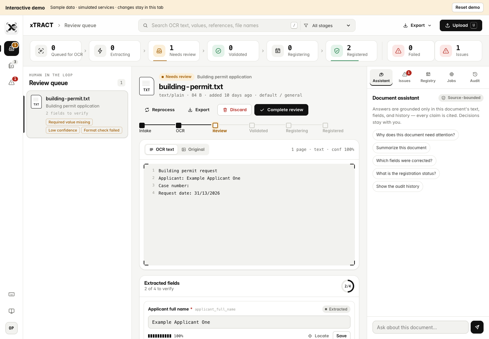

# xTRACT

A document processing app that reads files, extracts useful fields, and lets people review the results.

[Open the demo](https://kokutbon.github.io/xTRACT/) · [Technical documentation](docs/configuration.md)

## Features

- Upload PDFs, scans, photos, and text files.
- Extract dates, amounts, reference numbers, and other fields.
- Review uncertain values and export structured records.

## Screenshots



## Technology

Python 3.11+, SQLite, Tesseract OCR, JavaScript web console.

## Run the demo locally

```sh
git clone https://github.com/KOKUTBON/xTRACT.git
cd xTRACT
python3 scripts/build_demo.py
python3 -m http.server 8000 --directory dist/demo
```

Open http://localhost:8000/. The browser demo uses sample data. See the technical documentation for the full application setup.

## License

[Apache License 2.0](LICENSE).
