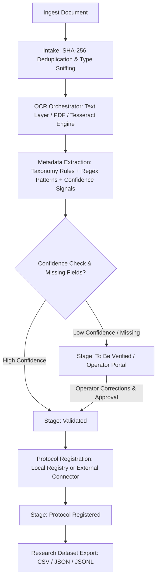

<p align="center">
  <picture>
    <source media="(prefers-color-scheme: dark)" srcset="assets/branding/logo-dark.svg">
    
  </picture>
</p>

# xTRACT — Local-First Document Intake, OCR, and Metadata Extraction

[](https://github.com/KOKUTBON/xTRACT/actions/workflows/ci.yml)
[](https://github.com/KOKUTBON/xTRACT/actions/workflows/codeql.yml)
[](LICENSE)
[](https://www.python.org/downloads/)
[](pyproject.toml)

**xTRACT** transforms incoming documents — PDFs, scans, photos, and plain text files — into validated, structured metadata. It orchestrates OCR fallback across multiple engines, classifies document archetypes, extracts key fields (dates, amounts, reference numbers, parties), and gates uncertain values to human reviewers in an interactive side-by-side web portal. Every action is immutably recorded in an audit trail, and validated outcomes can be exported as structured datasets for downstream systems or machine learning research.

Engineered with a **strict local-first architecture**: runs entirely on a laptop or private server with zero external cloud dependencies, zero external database requirements, and zero third-party telemetry.

---

## Architecture & Lifecycle Workflow



---

## Operator Console

The built-in web console is where people and the pipeline meet: a live workflow pipeline, a review queue, side-by-side OCR text and extracted fields, a source-bounded assistant, and an immutable audit trail — in light and dark themes, with keyboard shortcuts and drag-and-drop intake. It ships as plain ES modules with zero build step and a strict Content Security Policy.

| Shortcut | Action | Shortcut | Action |
| :---: | :--- | :---: | :--- |
| <kbd>/</kbd> | Search documents | <kbd>J</kbd> / <kbd>K</kbd> | Next / previous document |
| <kbd>U</kbd> | Upload documents | <kbd>1</kbd> <kbd>2</kbd> <kbd>3</kbd> | Review · Documents · Exceptions |
| <kbd>O</kbd> | Toggle OCR text / original | <kbd>A</kbd> | Ask the assistant |
| <kbd>T</kbd> | Cycle light / dark / system theme | <kbd>?</kbd> | Show all shortcuts |

Documents are deep-linkable (`/#doc=<document_id>`), so a review can be shared with a colleague on the same instance.

---

## Benchmark Results

xTRACT includes a reproducible benchmark test suite (`benchmarks/`) evaluating classification, field precision, exact match rates, and execution latency across synthetic administrative and financial document archetypes:

| Task / Metric | Result | Target | Status |
| :--- | :---: | :---: | :---: |
| **Document Classification Accuracy** | **100.0%** | ≥ 90.0% | :white_check_mark: Passed |
| **Overall Field Precision** | **100.0%** | ≥ 90.0% | :white_check_mark: Passed |
| **Overall Field Recall** | **100.0%** | ≥ 85.0% | :white_check_mark: Passed |
| **Overall Field F1 Score** | **100.0%** | ≥ 85.0% | :white_check_mark: Passed |
| **Field Exact Match Rate** | **100.0%** | ≥ 85.0% | :white_check_mark: Passed |
| **Auto-Validation Precision** | **100.0%** | ≥ 90.0% | :white_check_mark: Passed |
| **Mean Processing Latency** | **~35 ms** | < 250 ms | :white_check_mark: Passed |

Execute the benchmark suite locally:
```bash
xtract benchmark
```

---

## Key Features

- **Document Intake & Deduplication**: Real content sniffing, SHA-256 integrity hashing, duplicate detection, and size limits.
- **Multi-Engine OCR with Fallback**: Tries embedded text extraction and PDF text layers first for instant speed; falls back to Tesseract OCR for scans and images.
- **Resource Exhaustion Safeguards**: Decompression bomb protection, per-page pixel limits (`25M`), total document pixel caps (`100M`), maximum dimension bounds (`5000px`), per-page timeouts (120s), and global execution deadlines.
- **Rule-Based Metadata Extraction**: Taxonomy-driven field extraction blending label aliases (English & Italian included), regular expressions, normalization chains, and OCR confidence scoring.
- **Operator Console**: Zero-build ES-module web app with a live workflow pipeline, side-by-side OCR/field review with one-click source highlighting, confidence meters, lifecycle stepper, exception triage, audit timeline, drag-and-drop intake, keyboard shortcuts, and light/dark themes.
- **Institutional Integration**: Built-in sequential registration registry with support for external protocol systems via HTTPS connectors with retry handling.
- **Source-Bounded QA Assistant**: In-portal assistant answering questions grounded strictly in the document's own verified text with explicit citations.
- **Research Data Export**: Export human-verified and extracted values in CSV, JSON, and streaming JSON Lines formats pairing field provenance with OCR bounding boxes.
- **Contract-First & OpenAPI 3.1**: Built on JSON Schemas (draft 2020-12) with full OpenAPI 3.1.0 specifications in [`docs/openapi.yaml`](docs/openapi.yaml).

---

## Requirements

- **Python**: 3.11, 3.12, or 3.13
- **Operating System**: Linux, macOS, or Windows (via WSL2 or Docker)
- **Optional OCR Engine**: [Tesseract OCR 5+](https://tesseract-ocr.github.io/tessdoc/Installation.html) with language packs (e.g. `tesseract-ocr-eng`, `tesseract-ocr-ita`) for scanned PDFs and image processing. Embedded PDF text and plain text parsing work out-of-the-box without Tesseract.

---

## Installation

### Local Setup

```bash
git clone https://github.com/KOKUTBON/xTRACT.git
cd xTRACT
python3 -m venv .venv
source .venv/bin/activate
pip install -r requirements.txt
pip install -e .
```

Verify available OCR engines on your host:
```bash
xtract engines
```

### OCR Engine Dependencies (Optional)

- **macOS**: `brew install tesseract tesseract-lang`
- **Ubuntu/Debian**: `sudo apt install tesseract-ocr tesseract-ocr-ita tesseract-ocr-eng`

### Docker Setup

Run xTRACT in a container with Tesseract and five pre-installed language packs (English, Italian, French, German, Spanish):

```bash
docker build -t xtract .
docker run -p 127.0.0.1:8000:8000 -v xtract-data:/data xtract
```

---

## Configuration

xTRACT runs with zero configuration by default. To customize ports, data directories, API security tokens, or OCR settings, copy the documented [`.env.example`](.env.example) template:

```bash
cp .env.example .env
```

Load these values through your shell, service manager or Docker's `--env-file`.
The application does not automatically read `.env` files.

Key environment variables include:

| Variable | Default | Purpose |
| :--- | :--- | :--- |
| `XTRACT_HOST` | `127.0.0.1` | Network interface to bind |
| `XTRACT_PORT` | `8000` | HTTP port |
| `XTRACT_DATA_DIR` | `./data` | Directory for SQLite database and blob storage |
| `XTRACT_API_TOKEN` | *(empty)* | Require `Authorization: Bearer <token>` for API access |
| `XTRACT_TESSERACT_LANG` | `eng` | Tesseract language codes (e.g. `ita+eng`) |

For the full list of configuration options, see [docs/configuration.md](docs/configuration.md).

---

## Institution implementations

Create a separate implementation bundle for each institution. Configure branding,
offices, document rules and integrations without changing the application code:

```bash
xtract init-institution --output /srv/xtract/city-demo --institution city-demo --name "City Demo" --pack it-pa --locale it
xtract --deployment /srv/xtract/city-demo validate-config
xtract --deployment /srv/xtract/city-demo doctor
```

Supply `XTRACT_JWT_SECRET` through the service environment before startup. See the
[institution implementation handbook](docs/institution-implementation.md) for user
provisioning, configuration, acceptance and go-live requirements.

---

## Quick Start

Start the web portal and HTTP server:
```bash
xtract serve
```
Open <http://127.0.0.1:8000> in your browser, click **Upload**, and select documents to process.

---

## Command Line Interface

```bash
# Ingest and process documents
xtract ingest scans/*.pdf
xtract ingest letter.txt --family general_correspondence

# Process pending background jobs synchronously
xtract process

# Export research datasets
xtract export --format csv -o fields.csv
xtract export --format jsonl --include-text -o dataset.jsonl
xtract export --stage all --format json

# Run reproducible extraction benchmark suite
xtract benchmark
```

All commands support `--data-dir <path>` to configure storage locations (defaults to `./data`).

---

## Testing

Run unit tests, benchmarks, and code quality checks locally:

```bash
# Run full unit and integration test suite
make test

# Run extraction benchmarks
xtract benchmark

# Run linting and formatting validation
make lint
make format-check

# Run full CI validation pipeline
make ci
```


---

## Supported Document Types

| Family | Document Type Code | Fields Extracted |
| --- | --- | --- |
| **General Correspondence** | `general_correspondence` | `document_date`, `reference_number`, `sender_name`, `recipient_name`, `subject` |
| **Invoice** | `invoice` | `invoice_number`, `invoice_date`, `supplier_name`, `vat_number`, `total_amount` |
| **Building Permit** | `building_permit_application` | `applicant_full_name`, `case_number`, `request_date`, `property_address` |
| **Residence Application** | `residence_application` | `applicant_full_name`, `application_number`, `request_date`, `new_address` |

Adding custom document types requires only JSON configuration in `config/field-taxonomy.v1.json`, `config/alias-dictionary.v1.json`, and `config/extraction-policy.v1.json`. See the step-by-step [Custom Document Types Guide](docs/custom_document_types.md) and [Configuration Guide](docs/configuration.md).

---

## Local-First Security Architecture

xTRACT is designed from the ground up to protect confidential administrative and private citizen data:
- **No Remote Egress**: Document contents, OCR text, and extracted fields are never sent over the Internet.
- **Strict Bearer Authentication**: When `XTRACT_API_TOKEN` is configured, endpoints mandate `Authorization: Bearer <token>`. Query-string tokens (`?access_token=...`) are rejected to prevent credential leaks in logs.
- **Session-Scoped Token Storage**: Portal credentials reside in browser `sessionStorage` rather than persistent `localStorage`.
- **Memory-Safe Previews**: Previews use authenticated requests creating ephemeral `blob:` URLs that are revoked immediately after rendering.
- **DoS Protections**: Pixel limits, dimension guards, and strict processing deadlines abort decompression bombs and oversized files.

See [SECURITY.md](SECURITY.md) for full deployment hardening guidelines.

---

## Repository Structure

```
src/xtract/
  api/                  WSGI HTTP server, authentication, REST routes
  assistant/            Source-bounded document QA assistant
  contracts/            JSON Schemas (draft 2020-12) and lifecycle catalogs
  defaults/             Packaged fallback configuration files
  extraction/           Taxonomy matching, alias regex rules, normalizers
  intake/               Ingestion, media type detection, deduplication
  integration/          Protocol connectors and dispatch workers
  ocr/                  Engines (Plain Text, PDF, Tesseract) and orchestrator
  review/               CQRS read models, projections, commands, exports
  storage/              SQLite runtime database, job queue, blob storage
  cli.py                Command-line interface entry points
apps/operator-portal/   Zero-build ES-module Operator Console (HTML, CSS, JS)
assets/branding/        Logo, wordmark, and app icon
benchmarks/             Reproducible benchmark suite, evaluator, and dataset
config/                 Runtime taxonomy, alias dictionary, and policies
docs/                   OpenAPI 3.1 spec, architecture, configuration, [custom document types](docs/custom_document_types.md)
tests/                  Automated unit, contract, frontend, and API tests
```

---

## Research & Academic Use

The **Export** utility produces validated datasets pairing extracted metadata with ground-truth operator edits, OCR line confidence, and source line bounding boxes. Ideal for evaluating OCR accuracy (CER/WER) and training extraction models.

If you use xTRACT in academic or research publications, please cite:

```bibtex
@software{doda2026xtract,
  author = {Doda, Rei},
  title = {xTRACT: Local-First Document Intake, OCR, and Metadata Extraction Platform},
  year = {2026},
  url = {https://github.com/KOKUTBON/xTRACT}
}
```

---

## Contributing

Contributions are warmly welcomed! Please read [CONTRIBUTING.md](CONTRIBUTING.md) for guidelines, and run `make ci` before submitting pull requests.

## License

[Apache 2.0](LICENSE) © 2026 Rei Doda

## Static GitHub Pages demo

Build a backend-free interactive demo with `python3 scripts/build_demo.py`.
The output is `dist/demo/`; preview and manual publication instructions are in
[GitHub Pages demo](docs/github-pages-demo.md). The publishing workflow is manual
only, so pushing changes does not deploy the demo.

## KOKUTBON community and support

Open technology for the benefit of humankind — built by people, for people, and freely reusable by everyone.

Read [Contributing](CONTRIBUTING.md), [Code of Conduct](CODE_OF_CONDUCT.md), [Support](SUPPORT.md), [Governance](GOVERNANCE.md) and [Security](SECURITY.md). Help sustain the work through [GitHub Sponsors and other contributions](SPONSORSHIP.md). Maintainer release requirements are documented in [Release checklist](RELEASE_CHECKLIST.md).

## Source publication

See [source publication status](SOURCE_PUBLICATION.md) and [local validation record](PUBLICATION_VALIDATION.md) for the initial distribution and remaining release checks.
