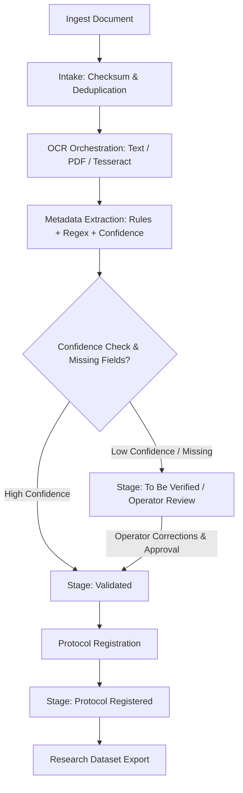

# Architecture

xTRACT is structured as a cohesive, local-first Python package in [`src/xtract/`](../src/xtract/) with a clean separation of concerns:

- `src/xtract/intake/`: Ingestion service, file type detection, SHA-256 deduplication, and initial job dispatching.
- `src/xtract/ocr/`: Multi-engine OCR orchestrator (`Plain Text`, `PDF Text`, and `Tesseract`) with graceful degradation and resource exhaustion guards.
- `src/xtract/extraction/`: Metadata extraction pipeline combining taxonomy, regex patterns, anchor aliases, normalizers, and OCR confidence signals.
- `src/xtract/review/`: Operator commands, CQRS-style read-model projections (`BackofficeProjections`), workspace models, and research dataset exporters.
- `src/xtract/integration/`: External and local institutional registration protocol connectors and reliable dispatching.
- `src/xtract/assistant/`: Source-bounded, citation-backed document QA assistant.
- `src/xtract/storage/`: SQLite transactional runtime database, persistent job queue, and local blob storage.
- `src/xtract/api/`: Security-hardened WSGI HTTP server, REST endpoints, and static web portal hosting.
- `src/xtract/contracts/`: JSON Schemas (draft 2020-12) and lifecycle catalogs governing internal payloads.

The portal in `apps/operator-portal/` uses native browser JavaScript (ES modules), CSS, and HTML with no build step, no NPM dependencies, and no CDN calls.

## Document Lifecycle Workflow

1. **Intake** verifies mime-type, content length, computes a SHA-256 hash, stores the original file in local object storage, and enqueues an OCR job.
2. **OCR Orchestrator** attempts text extraction via plain-text parsing or embedded PDF text layers, and falls back to Tesseract OCR when needed.
3. **Metadata Extractor** identifies document families from keywords, matches anchor aliases and regex patterns, normalizes dates and numbers, and blends OCR confidence.
4. **Human Review** flags low-confidence or required-missing values. Operators review and correct fields in the side-by-side portal.
5. **Protocol Integration** issues sequential local registration numbers or dispatches to external institutional endpoints with retry logic.
6. **Research Export** produces structured CSV or JSON Lines datasets pairing extracted values with human-verified truth.

## Security & Deployment Model

xTRACT is intentionally designed as an unbloated, single-instance, local-first application:
- No third-party network egress or external cloud dependencies.
- No external database server required; SQLite with WAL mode handles concurrency.
- API authorization uses standard `Authorization: Bearer <token>` headers (query parameter credentials strictly disallowed).
- Operator tokens reside in `sessionStorage` rather than `localStorage`.
- Content-Security-Policy (CSP) headers enforce frame isolation and blob URL sanitization.
